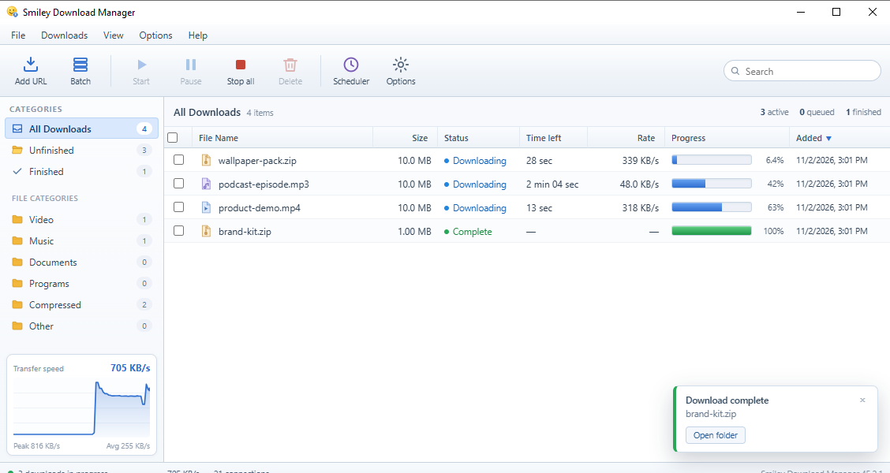
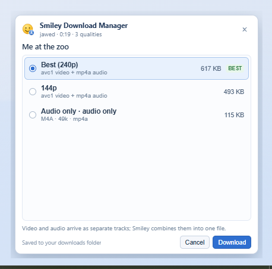
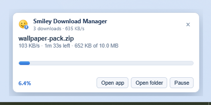
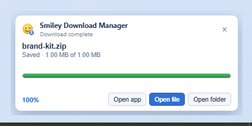
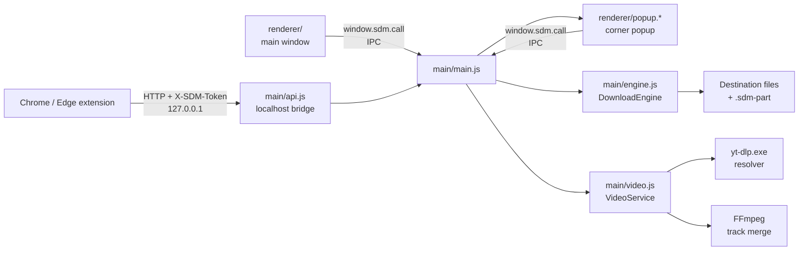
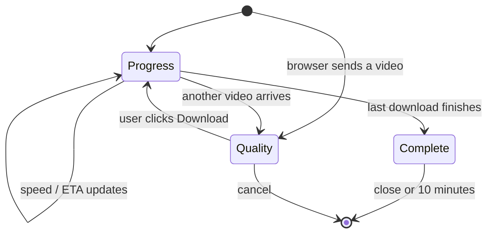

# Smiley Download Manager

<p align="center">
  
</p>

<p align="center">
  <b>A fast, IDM-style download manager for Windows</b><br>
  Real multi-connection downloads, a compact desktop UI, and a Chrome / Edge extension.
</p>

<p align="center">
  
  
  
  
</p>

> Independent project. Not affiliated with or endorsed by Internet Download Manager (IDM).
> 
| Installer (recommended) | [`Smiley Download Manager-Setup-1.0.0.exe`](release/Smiley%20Download%20Manager-Setup-1.0.0.exe) |
| Portable | [`Smiley Download Manager-Portable-1.0.0.exe`](release/Smiley%20Download%20Manager-Portable-1.0.0.exe) |
---

## Screenshots



| Quality picker in the corner popup | Active download popup | Finished download popup |
| --- | --- | --- |
|  |  |  |

The corner popup is a real, transparent, always-on-top window. Browser downloads use it on its
own, so downloading a video from YouTube never opens the full manager.

---

## Contents

- [Features](#features)
- [Requirements](#requirements)
- [Install the desktop app](#install-the-desktop-app)
- [Install the browser extension](#install-the-browser-extension)
- [Quick tour](#quick-tour)
- [Video downloads (YouTube and other pages)](#video-downloads-youtube-and-other-pages)
- [Build and run from source](#build-and-run-from-source)
- [Project structure](#project-structure)
- [How it works](#how-it-works)
- [Configuration](#configuration)
- [Customization cookbook](#customization-cookbook)
- [Testing](#testing)
- [Packaging and releases](#packaging-and-releases)
- [Troubleshooting](#troubleshooting)
- [Security and privacy](#security-and-privacy)
- [License](#license)

---

## Features

### Downloads

- Segmented HTTP/HTTPS downloads with up to 32 connections per file
- Pause, resume, retry, stop-all and start-all
- Queue with a configurable number of simultaneous downloads
- Optional global speed limit, live speed graph, ETA and per-connection counters
- Resumable downloads across app restarts
- Redirects, `Content-Disposition` file names, unknown-size downloads and non-resumable servers
- Batch import of up to 500 URLs
- Optional clipboard monitoring and a start/stop scheduler
- Remove a download instantly, optionally deleting the file from disk

### Interface

- Compact IDM-style window that remembers its size and position
- Category tree, sortable download grid, row checkboxes and select-all
- Details dialog with live progress, link, save path, connections, timestamps and actions
- In-app toast notifications and a tray icon
- IDM-style corner popup with **Open app**, **Open file**, **Open folder**, **Pause** and
  **Resume**
- Browser-triggered video downloads show their quality picker in that popup, not in the main window

### Browser integration

- Chrome / Edge Manifest V3 extension
- Hands normal browser downloads to the desktop app
- **Download** button inside the YouTube player
- Media sniffer for direct video/audio links on the current page
- IDM-style floating panel with **Download** / **Download all** on pages that expose media
- Optional automatic hand-off of detected media
- Loopback bridge (`127.0.0.1`) protected by a pairing token

### Video downloads

- Quality picker generated from the real formats the page offers
- Separate video + audio tracks are downloaded under one row and combined with FFmpeg
- Pause/resume and the segmented engine apply to video downloads too
- Signed stream URLs stay inside the main process
- DRM, live and private / region-locked videos are refused with an honest message

---

## Requirements

### To run the app

- Windows 10 or Windows 11, 64-bit
- Chrome 116+ or Edge 116+ for browser integration
- No Node.js installation is needed for the installer or portable build

### To build from source

- Node.js 22 or newer (Node 24 is used for development)
- npm 10 or newer
- Windows (the packaging targets are Windows x64)
- Optional: internet access the first time `npm install` downloads Electron

---

## Install the desktop app

You can download both builds from this repository:

| Build | File |
| --- | --- |
| Installer (recommended) | [`Smiley Download Manager-Setup-1.0.0.exe`](release/Smiley%20Download%20Manager-Setup-1.0.0.exe) |
| Portable | [`Smiley Download Manager-Portable-1.0.0.exe`](release/Smiley%20Download%20Manager-Portable-1.0.0.exe) |

> The `.exe` files are stored with **Git LFS**. On the GitHub file page click **Download**.
> Cloning without Git LFS leaves small pointer files instead of the binaries.

### Installer

1. Run `Smiley Download Manager-Setup-1.0.0.exe`.
2. Choose an installation folder (or keep the default).
3. Finish the wizard. Desktop and Start menu shortcuts are optional.
4. Windows SmartScreen may warn because the build is not code-signed. Click **More info** and
   **Run anyway** only if you built or downloaded it from this repository.

### Portable

Run `Smiley Download Manager-Portable-1.0.0.exe`. Nothing is installed, and settings are still
stored in `%APPDATA%\Smiley Download Manager`.

### Verify a download (optional)

```powershell
Get-FileHash ".\Smiley Download Manager-Setup-1.0.0.exe" -Algorithm SHA256
Get-FileHash ".\Smiley Download Manager-Portable-1.0.0.exe" -Algorithm SHA256
```

Compare the result with the checksums in [`release/CHECKSUMS.txt`](release/CHECKSUMS.txt).

Downloads are saved to `Downloads\Smiley Download Manager` by default. Change it in
**Options → General**.

---

## Install the browser extension

1. Start **Smiley Download Manager**.
2. In the app, open **Options → Browser integration**. Keep the window open; you need the
   **pairing token** and **port** from this page.
3. Click **Open extension folder**.
   - Installed app: opens the bundled `browser-extension` folder next to the app.
   - Source run: opens `extension\` in this repository.
4. In Chrome open `chrome://extensions`; in Edge open `edge://extensions`.
5. Turn on **Developer mode**, click **Load unpacked**, and select the folder from step 3.
6. Open the extension's **Options** page, paste the token (and port if you changed it), then click
   **Save settings**. Use **Test connection** to confirm the pairing.
7. Keep Smiley running. Browser downloads now go to Smiley, and the toolbar popup lists direct
   media found on the current page.

After updating the app, reload the extension in `chrome://extensions` if old labels or behavior
remain cached.

### How pairing works

- The app listens on `http://127.0.0.1:6389` by default.
- If that port is busy it tries the next 11 ports (up to `6400`). The actual port is shown in
  **Options → Browser integration**.
- Every data request must include the `X-SDM-Token` header.
- Regenerating the token in the app makes the extension stop working until you paste the new token
  into the extension options.

---

## Quick tour

- **Add URL (`Ctrl+N`)** — paste a link; the app probes it and shows size, resume support and
  category.
- **Batch** — add up to 500 links, one per line.
- **Toolbar** — Add URL, Batch, Start/Resume, Pause, Stop all, Delete, Scheduler, Options.
- **Selecting** — use row checkboxes or click a row. Start, Pause and Delete act on the selection.
- **Details** — click a file name (or press `Alt+Enter`) for the properties dialog.
- **Delete** — removes the row immediately. Tick *Also delete the downloaded file* to erase it.
- **Queue** — extra downloads wait in the *queued* state based on **Simultaneous downloads**.
- **Pause / resume** — the partial file stays next to the destination (`<name>.sdm-part`), so a
  resumed download continues where it stopped, even after restarting the app.
- **Scheduler** — start or pause the queue at set times.
- **Clipboard monitoring** — optional notification when a direct download link is copied.
- **Tray** — closing the window keeps the app running. Right-click the smiley to quit.
- **Window** — opens compact (about two thirds of the screen, maximum 1080×700) and remembers the
  size and position you leave it at. Delete `window.json` in the data folder to reset it.

Default settings: 3 simultaneous downloads, 16 connections per download, no speed limit.

### The corner popup

The popup appears when the main window is hidden and something is happening:

1. **Progress** — file name, speed, ETA, size, percentage and **Pause**.
2. **Complete** — stays on screen with **Open file** and **Open folder**, so you can act on the
   finished download without opening the manager. It stays for 10 minutes or until dismissed.
3. **Quality picker** — for a video sent from the browser, the popup lists the available qualities
   with sizes and a **BEST** badge. Choose one and click **Download**.

---

## Video downloads (YouTube and other pages)

There are three ways to start a video download:

- **File → Download video…** in the app.
- The **Download** button that the extension adds inside the YouTube player.
- Sending a direct media URL from the extension.

The app resolves the page with **yt-dlp**, builds a quality list, then downloads the selected
streams with its own multi-connection engine.

- The resolver is installed from **Options → Video** on first use.
- FFmpeg is only needed for qualities that arrive as separate video and audio tracks (usually
  720p and above). Smiley downloads both tracks under one visible row, combines them without
  re-encoding, and removes the tracks unless **Keep the separate tracks** is enabled.
- Direct media files (`https://site/video.mp4`, `https://site/song.mp3`, …) are downloaded directly.
- Protected content is refused: DRM formats, live streams, and private or region-locked videos
  report an error instead of being worked around.

**Download only what you are allowed to keep.**

---

## Build and run from source

```bash
git clone https://github.com/sakahaout99-cloud/Smiley_Download_Manager.git
cd Smiley_Download_Manager
npm install
npm start
```

Useful commands:

| Command | What it does |
| --- | --- |
| `npm start` | Run the app from source |
| `npm run dev` | Run with the `--dev` flag |
| `npm test` | Run the Node test suite (no network required) |
| `npm run icons` | Regenerate PNG/ICO icons from `assets/logo.svg` |
| `npm run pack` | Build an unpacked app in `dist/win-unpacked/` |
| `npm run dist` | Build the NSIS installer and portable `.exe` into `dist/` |

### Source-run notes

- The source app uses the same data folder as the installed app.
- On the first source run, Windows cannot find a shortcut for the taskbar identity, so the app
  writes `Smiley Download Manager (dev).lnk` (with `assets/icon.ico`) into the per-user Start Menu
  and claims it from the next run. Delete that shortcut to undo it. Installed builds never touch it.
- Running two versions at once is blocked by Electron's single-instance lock.
- The in-app **Open extension folder** opens `extension\` in a source run and the bundled copy in an
  installed build.

### Cloning only the source (without the 230 MB of installers)

```bash
GIT_LFS_SKIP_SMUDGE=1 git clone https://github.com/sakahaout99-cloud/Smiley_Download_Manager.git
```

Later, if you want the binaries:

```bash
git lfs pull
```

---

## Project structure

```text
smiley-download-manager/
├─ main/                  Electron main process
│  ├─ main.js             App lifecycle, window, tray, scheduler, popup, IPC, bridge wiring
│  ├─ engine.js           Segmented download engine, queue, retries, speed limit, merge rows
│  ├─ video.js            yt-dlp resolver, quality plans, FFmpeg install/merge
│  ├─ api.js              Token-protected localhost bridge for the extension
│  ├─ preload.js          contextBridge API: window.sdm.call / window.sdm.onEvent
│  └─ store.js            Atomic JSON read/write helpers
├─ renderer/              Desktop UI (no framework)
│  ├─ index.html          Main window markup
│  ├─ app.js              Main window logic and dialogs
│  ├─ styles.css          Theme and layout
│  ├─ popup.html/.js/.css Corner download popup
├─ extension/             Chrome / Edge MV3 extension (load unpacked)
│  ├─ manifest.json       Permissions, content script, service worker
│  ├─ background.js       Download interception, media sniffing, bridge calls
│  ├─ content.js          In-page Download button and media panel
│  ├─ popup.html/.js      Toolbar popup
│  └─ options.html/.js    Token and port settings
├─ test/                  node:test suites
├─ scripts/               Icon generation helpers
├─ assets/                App, tray and extension icons
├─ docs/screenshots/      README images
├─ release/               Installer and portable exe (Git LFS)
├─ package.json           Scripts and electron-builder configuration
└─ LICENSE
```

---

## How it works

### Process layout



- **Main process** owns the windows, tray, settings, download engine and video resolver.
- **Renderer** is a plain HTML/CSS/JS UI. It never touches Node APIs directly.
- **Preload** exposes only `window.sdm.call(method, payload)` and `window.sdm.onEvent(fn)` through
  `contextBridge`.
- **Extension** is a separate MV3 service worker plus content scripts. It only talks to the local
  bridge.

### A normal browser download

1. The extension sees `chrome.downloads.onCreated`, cancels the browser download and sends
   `POST /api/add` with the URL and cookies.
2. `main/api.js` verifies the token and calls the engine.
3. The engine probes the URL, plans segments and starts downloading into `<file>.sdm-part`.
4. `main/main.js` shows the corner popup (or the main window for non-download actions).
5. When every segment is done, the engine verifies the size, renames `.sdm-part` to the final file,
   deletes the part folder, and emits `completed`.
6. The popup switches to the completion card with **Open file** and **Open folder**.

### A YouTube download from the browser

1. The extension sends `POST /api/video/add`.
2. `video.js` runs `yt-dlp -J` and keeps the signed stream URLs in the main process.
3. `summarizePlan()` strips the URLs and returns only labels, sizes and keys.
4. If **Ask for quality** is enabled, the main process stores the pending plan (30-minute TTL) and
   shows the quality picker in the corner popup.
5. `videoStart` queues the chosen stream, or two hidden tracks plus one visible merge row.
6. FFmpeg combines the tracks with stream copy (`-c copy`), then the hidden rows are removed.
7. The popup shows one combined progress row and one completion card.

### Download engine

`main/engine.js` (`DownloadEngine`) handles:

- HEAD/GET probing, byte ranges and resumable servers
- 1–32 connections, split into equal byte ranges (`planParts`)
- Random-access writes into the shared `.sdm-part` file
- Retry with backoff and offset validation after interruptions
- Queue slots (`maxConcurrent`), grouped jobs, pause/resume, remove and persistence
- Speed sampling, ETA and an optional global speed limit
- Download kinds: `file`, `video-stream`, `merge`, `tool`
- Hidden track rows and a derived merge view (`_mergeView`) so the list shows one movie, not three
  files

### Local bridge

`main/api.js` binds to `127.0.0.1` only and starts at the configured port, trying the next 11 ports
if needed.

| Method | Route | Purpose |
| --- | --- | --- |
| GET | `/api/ping` | Health check (no token) |
| GET | `/api/status` | Counts and recent downloads |
| GET | `/api/list` | Full download list |
| POST | `/api/add` | Add one URL |
| POST | `/api/add-batch` | Add many URLs |
| GET | `/api/video/status` | Resolver/FFmpeg status |
| POST | `/api/video/resolve` | Resolve a page into a quality plan |
| POST | `/api/video/start` | Start a pending plan |
| POST | `/api/video/add` | Browser flow: resolve and show the popup picker |
| POST | `/api/video/install` | Install yt-dlp or FFmpeg |
| POST | `/api/video/cancel-install` | Cancel a tool install |
| POST | `/api/pause` / `/api/resume` | Pause or resume one download |
| POST | `/api/pause-all` / `/api/start-all` | Pause or resume everything |
| POST | `/api/remove` | Remove a row (optionally delete the file) |
| POST | `/api/open-folder` | Reveal a file in Explorer |

All data routes require `X-SDM-Token`. The token comparison uses `crypto.timingSafeEqual`.

### Popup states



`main/main.js` keeps the pending plan (`popupPlan`), resizes the popup between 390×176 (progress)
and 424×416 (quality), and forwards the plan if the full window is opened instead.

---

## Configuration

Settings, download history, the window position and the pairing token live outside the repository:

```text
%APPDATA%\Smiley Download Manager\
├─ settings.json          User settings
├─ downloads.json         Download list and resume state
├─ window.json            Last window size and position
├─ token.txt              Bridge pairing token
└─ tools\
   ├─ yt-dlp.exe          Video resolver (installed on demand)
   └─ ffmpeg\bin\ffmpeg.exe
```

### Settings reference

| Key | Default | Meaning |
| --- | --- | --- |
| `defaultDir` | `Downloads\Smiley Download Manager` | Default save folder |
| `maxConcurrent` | `3` | Downloads allowed to run at once |
| `connections` | `16` | Connections per download (1–32) |
| `speedLimitKB` | `0` | Global limit in KB/s; `0` means unlimited |
| `autoCategorize` | `false` | Save into `Video`, `Music`, `Documents`, … subfolders |
| `autoResume` | `true` | Resume unfinished downloads on launch |
| `closeToTray` | `true` | Closing the window hides it to the tray |
| `startWithWindows` | `false` | Start minimized with Windows |
| `watchClipboard` | `false` | Notify when a direct link is copied |
| `notifyOnComplete` | `true` | Show Windows notifications |
| `showPopup` | `true` | Use the corner popup |
| `apiPort` | `6389` | First bridge port to try |
| `schedule` | `[]` | Start/pause times |
| `videoEnabled` | `true` | Enable the video resolver |
| `videoKeepParts` | `false` | Keep separate video/audio tracks after merging |
| `videoAskQuality` | `true` | Show the quality picker |
| `videoHelperPath` | `""` | Custom `yt-dlp.exe` |
| `ffmpegPath` | `""` | Custom `ffmpeg.exe` |

Change defaults in `DEFAULT_SETTINGS` in [`main/main.js`](main/main.js). Runtime changes must also
be allowed in `sanitizeSettingsPatch()` if you add a new key.

---

## Customization cookbook

This section maps common changes to the files you need to edit.

### Rename the app or change its version

- `package.json`: `name`, `productName`, `version`, `build.appId`, `build.shortcutName`,
  `build.nsis.artifactName`, `build.portable.artifactName`
- `main/main.js`: `APP_ID` (must match the installed shortcut / AppUserModelID)
- `extension/manifest.json`: `name`, `short_name`, `version`, `description`
- `README.md`, `LICENSE` and screenshots as needed

After changing the version, rebuild the installers.

### Change colors or fonts

- Main window: CSS variables at the top of [`renderer/styles.css`](renderer/styles.css)
  (`--accent`, `--bg`, `--panel`, `--text`, …)
- Corner popup: [`renderer/popup.css`](renderer/popup.css)
- Extension popup/options: `extension/popup.css`, `extension/options.css`

### Change the default window size

- `compactBounds()` in [`main/main.js`](main/main.js) controls the first-run size.
- `windowBounds()` restores the saved size from `window.json`.
- Minimum sizes are passed to the `BrowserWindow` in `createWindow()`.

### Change the corner popup size or position

- `popupBounds()` in [`main/main.js`](main/main.js): progress is 390×176, quality is 424×416.
- Update [`renderer/popup.html`](renderer/popup.html) and
  [`renderer/popup.css`](renderer/popup.css) to fit the new dimensions.
- `showPopupPlan()` and `clearPopupPlan()` switch between the two sizes.

### Change default behavior (settings)

- `DEFAULT_SETTINGS` in [`main/main.js`](main/main.js)
- `sanitizeSettingsPatch()` for validation of new keys
- `renderer/index.html` + `renderer/app.js` for the Options UI

### Add a toolbar button or dialog

1. Add the markup to the toolbar in `renderer/index.html`.
2. Handle the click in `renderer/app.js` and call `window.sdm.call('yourMethod', payload)`.
3. Add a `case 'yourMethod':` in `handleCall()` in `main/main.js`.
4. If it returns data, render it in the UI; if it changes downloads, call `engine` methods.

`preload.js` is generic, so you do not need to change it for a new IPC method.

### Add a bridge endpoint for the extension

1. Add a route in `main/api.js` inside the request handler.
2. Call it from `extension/background.js` with `fetch` and the `X-SDM-Token` header.
3. Keep the route token-protected; `/api/ping` is the only intentional exception.

### Change the YouTube quality rules

[`main/video.js`](main/video.js):

- `planFromInfo()` filters formats and builds the pick list.
- `groupLabel()` controls resolution/fps labels.
- The `recommended` flag adds the **BEST** badge.
- `summarizePlan()` decides what the renderer and extension are allowed to see. Never move signed
  stream URLs into that payload.

Tool download URLs are `YT_DLP_LATEST_URL` and `FFMPEG_ZIP_URL` in the same file.

### Change the extension UI

- In-page YouTube button and floating media panel: `extension/content.js`
- Toolbar popup: `extension/popup.html`, `extension/popup.js`, `extension/popup.css`
- Options page: `extension/options.html`, `extension/options.js`, `extension/options.css`
- Permissions and content-script matches: `extension/manifest.json`

Because the extension is loaded unpacked, click **Reload** in `chrome://extensions` after edits.

### Change icons

Replace [`assets/logo.svg`](assets/logo.svg) and run:

```bash
npm run icons
```

This regenerates `icon.png`, `icon512.png`, `tray.png`, `icon.ico` and the extension icons using an
installed Chrome or Edge.

### Add or change tests

- Tests use the built-in `node:test` runner.
- `test/helpers.js` starts a local HTTP server and provides fixtures.
- Add `test/your-feature.test.js`; `npm test` picks up `test/*.test.js` automatically.

---

## Testing

```bash
npm test
```

The suite runs without internet access:

- `test/api.test.js` — bridge authentication, add/list/pause/remove and CORS
- `test/engine.test.js` — segments, ranges, pause/resume, speed limit, merge rows, persistence
- `test/video.test.js` — plan filtering, signed URL stripping, FFmpeg detection, blocked content

When changing the engine or video flow, add a regression test that fails without your fix.

---

## Packaging and releases

```bash
npm run dist
```

Output in `dist/`:

```text
Smiley Download Manager-Setup-1.0.0.exe
Smiley Download Manager-Portable-1.0.0.exe
Smiley Download Manager-Setup-1.0.0.exe.blockmap
win-unpacked/            (only with npm run pack)
```

Packaging uses **electron-builder** with the `nsis` and `portable` targets for Windows x64. The
builder configuration lives in `package.json` under `build`.

To publish a new version to this repository:

1. Update `version` in `package.json` and `extension/manifest.json`.
2. Rebuild and test.
3. Copy the new `.exe` files into `release/` (they are tracked by Git LFS).
4. Regenerate `release/CHECKSUMS.txt`:

   ```powershell
   Get-FileHash .\release\*.exe -Algorithm SHA256 |
     ForEach-Object { "$($_.Hash.ToLower())  $([IO.Path]::GetFileName($_.Path))" } |
     Set-Content .\release\CHECKSUMS.txt
   ```

5. Commit, tag (`git tag v1.0.0`) and push.

The installers are unsigned. For public distribution, add a code-signing certificate to the
electron-builder configuration; that removes the SmartScreen warning over time.

---

## Troubleshooting

### The extension says the app is offline

- Is Smiley running? Closing the window sends it to the tray, so check the tray.
- Check the port in **Options → Browser integration** and in the extension options.
- Paste the current token; regenerate + re-paste if you clicked **Regenerate token**.
- Click **Test connection** in the extension options.
- A firewall or VPN must allow loopback `127.0.0.1`.

### The port is already in use

The app automatically tries the next 11 ports. Set a fixed port in **Options → General**, then use
the same port in the extension options.

### Browser downloads open the full manager instead of the popup

- Enable **Options → General → Show corner popup**.
- Make sure you are running the current build. In older builds, browser video downloads opened the
  main window to ask for quality.
- Reload the extension after updating the app.

### The quality picker does not appear

- The page must be a video page that yt-dlp can resolve.
- Private, DRM-protected, live or region-locked videos are refused by design.
- Open **Options → Video** and update the resolver.
- Check that **Ask for quality** is enabled; disabling it downloads the best format immediately.

### 720p or 1080p is unavailable

Those qualities usually ship as separate video and audio tracks. Install FFmpeg in
**Options → Video**, or choose a single-file quality.

### “Open folder” does nothing

The file may have been moved or deleted. Open the download's details and check its save path. The
bridge route requires the row to still exist.

### The window opens at the wrong size

The app restores `window.json` from `%APPDATA%\Smiley Download Manager`. Close the app, delete that
file, and start again to return to the compact default.

### The app does not close

**Options → General → Close to tray** is enabled by default. Right-click the tray smiley and choose
**Exit**, or disable that option.

### Taskbar shows the Electron icon (source run only)

Windows uses a shortcut with the matching AppUserModelID. A source run creates
`Smiley Download Manager (dev).lnk` in your Start menu on first launch; the icon is correct from
the next run. Installed builds already have the shortcut.

### SmartScreen blocks the installer

The build is not signed. Use **More info → Run anyway**, or build it yourself from source.

### Build fails because `app.asar` is locked

Close any running copy of the app and every source-run Electron instance, then run `npm run dist`
again. `dist/` is ignored by Git.

### The app is stuck on “Combining video and audio”

FFmpeg is still working, or it is waiting for a track to finish. Check the log in the download
details. If it stays there after the tracks are complete, update FFmpeg in **Options → Video** and
retry.

---

## Security and privacy

- The bridge binds to `127.0.0.1` only, never to a LAN address.
- Every data endpoint requires `X-SDM-Token`; comparison is timing-safe.
- The extension can read downloads, cookies and page media because that is what a download manager
  needs. It is loaded unpacked and runs only on your machine.
- Signed media URLs are resolved and kept in the main process. The extension never receives them.
- The app has no telemetry and no cloud account. Settings and history stay in `%APPDATA%`.
- yt-dlp and FFmpeg are third-party tools downloaded from their official release URLs. Review
  their licenses and source if you redistribute them.
- Only download content you have permission to keep. The app refuses DRM and live streams instead
  of bypassing protection.

Never commit your `token.txt`, `settings.json`, `downloads.json` or downloaded media. They are
outside this repository and ignored by Git.

---

## FAQ

**Is this IDM?**
No. It is an independent Electron app inspired by IDM's layout. It is not affiliated with or
endorsed by Internet Download Manager.

**Does it work on macOS or Linux?**
The packaging and window/tray code target Windows. The engine and tests are platform-neutral, but
the installers and shell integration are Windows-only.

**Can I use it commercially?**
The source is MIT-licensed. Third-party tools (yt-dlp, FFmpeg, Electron) have their own licenses.

**Why are the `.exe` files in Git LFS?**
They are about 110–120 MB each. LFS keeps the repository history small while still allowing a
single clone to fetch the binaries.

**Why is the installer unsigned?**
Code-signing certificates cost money. The build is reproducible from source; verify the SHA-256
checksums in `release/CHECKSUMS.txt`.

---

## Credits

- Built with [Electron](https://www.electronjs.org/) and
  [electron-builder](https://www.electron.build/).
- Video resolving by [yt-dlp](https://github.com/yt-dlp/yt-dlp).
- Merging by [FFmpeg](https://ffmpeg.org/).
- Icons and UI by Smiley Apps.

## License

[MIT](LICENSE) © 2026 Smiley Apps
